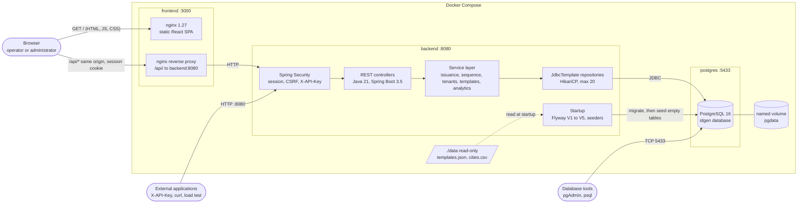

# Architecture overview

The Government ID Generator is a **modular monolith**: one Spring Boot service, one PostgreSQL database and a React
single-page app served by nginx, deployed together with Docker Compose. PostgreSQL is the single source of truth for every
counter, which is what makes duplicate IDs impossible even under parallel load.

| Document | Contents |
| --- | --- |
| This page | System architecture, startup, key decisions and trade-offs |
| [ID generation sequence](id-generation-sequence.md) | What happens, in order, when an ID is requested |
| [Data model](data-model.md) | Entity relationship diagram of the tables created by the Flyway migrations |
| [Concurrency](concurrency.md) | How simultaneous requests receive non-overlapping sequence ranges |

All diagrams are [Mermaid](https://mermaid.js.org/) and render directly on GitHub; edit them as text.

## High-level system architecture

**How to read it.** Container labels show the host ports (`:3000` nginx, `:8080` backend, `:5433` PostgreSQL, bound to
127.0.0.1). The browser loads the React app from nginx and sends every API call to the same origin under `/api/`;
nginx forwards those to the backend container, so no CORS setup is needed. The backend is also published on port 8080 for
API clients such as the HTTP load test. Spring Security runs before every controller: the ID, template and city endpoints are
public, admin endpoints need an authenticated ADMIN session, and state-changing admin calls need a CSRF token. External
applications authenticate with an `X-API-Key` header (stateless, role API_CLIENT): they may issue IDs only for their tenant
and permitted templates and can never reach admin endpoints. Only the
repository layer talks to PostgreSQL. Database data lives in the `pgdata` volume and survives container restarts. Port 5433 is
bound to `127.0.0.1` for local tools only.

### Startup order

Compose starts PostgreSQL first and waits for its health check (`pg_isready`); the backend starts only when the database is
healthy, and the frontend only when the backend accepts connections. On backend startup:

1. Flyway applies migrations V1 to V6 (an older database without migration history is baselined and upgraded in place).
2. `CityLoader` seeds `cities.csv`, and `TemplateSeeder` seeds `templates.json`, **only into empty tables**, so data managed
   in the UI is never overwritten.
3. `AdminBootstrap` creates the initial admin from `ADMIN_USERNAME` / `ADMIN_PASSWORD` if that username does not exist.
4. The named-counter start values are read from the `counters` section of `templates.json` (configuration, not state).

### Backend modules (packages under `com.egov.idgenerator`)

| Package | Responsibility |
| --- | --- |
| `controller` | HTTP mapping only; request validation with Bean Validation |
| `service` | Issuance orchestration, sequence scope and allocation, placeholder resolvers (CITY, FY, CY), tenant and template administration, analytics, startup seeders |
| `parser` | Generic template grammar: a format becomes literal and placeholder segments |
| `repository` | All SQL, through JdbcTemplate, including the atomic counter statements |
| `entity`, `dto` | Row records and API request/response records |
| `config` | Properties, business clock (Asia/Kolkata), Spring Security, named-counter configuration |
| `exception` | One JSON error format; no stack traces in responses |

## Key decisions and trade-offs

### Why a modular monolith

| | |
| --- | --- |
| **Decision** | One deployable Spring Boot service with clear package boundaries, not microservices. |
| **Why** | Issuing an ID touches templates, tenants, counters and issued IDs in one request. In one process with one database, these are plain method calls and local transactions: no network hops, no distributed transactions, no service discovery or message broker. The domain is small and owned by one team, and the assignment requires `docker compose up` to be the only setup step. |
| **Trade-off** | All modules scale and deploy together. A heavy admin feature (for example analytics) shares the JVM and connection pool with issuance. |
| **Why it is acceptable** | The backend holds no state between requests: counters live in PostgreSQL. More backend replicas behind a load balancer would stay correct without code changes. The package boundaries (`service`, `repository`, `parser`) are the seams along which a module could be extracted later if it ever needed separate scaling. |

### Why PostgreSQL allocates sequence numbers

| | |
| --- | --- |
| **Decision** | Each request reserves its whole range with one atomic `INSERT ... ON CONFLICT DO UPDATE ... RETURNING` on a counter row, in its own short transaction. Details in [Concurrency](concurrency.md). |
| **Why** | The database already guarantees durability, row-level locking and uniqueness. One statement creates the counter on first use, increments it, and returns the reserved range, so there is no read-modify-write window, and the state survives restarts and is shared by every backend instance. `UNIQUE(generated_id)` on `issued_ids` is a second, independent guarantee. |
| **Trade-off** | Requests for the *same* counter (same template or named counter, same tenant) are serialised on that row's lock for the duration of one statement. A database outage stops issuance. Sequence gaps are possible if a request fails after reserving numbers. |
| **Why it is acceptable** | Gaps are explicitly allowed by the brief; duplicates are not. Different tenants and templates use different rows and do not contend. In the local HTTP load test, 50 parallel requests of 100 IDs on one counter completed in about 0.1 to 0.2 seconds with no failures. |

**Alternatives considered**

| Alternative | Why not |
| --- | --- |
| In-memory counter (`AtomicLong`, `synchronized`) | Lost on restart and wrong as soon as two backend instances run. |
| PostgreSQL `SEQUENCE` objects | One sequence per (template, tenant) would mean creating database objects at runtime. Sequences are also not transactional with the rest of the request and do not reserve an arbitrary bulk range in one call. |
| Redis `INCRBY` | Extra infrastructure to run and back up, and weaker durability than the database that already holds the issued IDs. |
| `SELECT ... FOR UPDATE` then `UPDATE` | Correct, but two round trips, and it does not handle the very first request for a counter without extra logic. |

### Other decisions

| Decision | Reason | Trade-off |
| --- | --- | --- |
| JdbcTemplate instead of JPA | The critical path is a few precise SQL statements; explicit SQL keeps them visible and reviewable. | More hand-written mapping code. |
| Counter reservation in its own transaction (`REQUIRES_NEW`), issued IDs inserted in a second transaction | The counter row lock is held for one statement only. | A failure between the two leaves a gap, never a duplicate. |
| Identifier strings globally unique; formats without `[CITY]` share one counter across tenants | A per-tenant counter for `PGR-[SEQ:8]` would give two cities the same string. | City-less templates have one sequence for the whole deployment. |
| Templates immutable (database triggers reject UPDATE, DELETE and TRUNCATE) | Issued IDs can never disagree with the format that produced them. | A mistake is fixed by creating a new template ID. |
| Seed CSV/JSON only into empty tables | Tenants and templates managed through the UI survive restarts unchanged. | Changing the files later does not change existing data. |
| Business dates in Asia/Kolkata from an injected clock | FY, CY and analytics days follow Indian dates regardless of server timezone; tests use a fixed clock. | None significant. |
| Same-origin nginx proxy and session cookie with CSRF | No CORS configuration; cookies are HttpOnly and SameSite=Lax. | The admin API is not designed for token-based machine clients. |
| API keys for external applications (`X-API-Key`), not OAuth | Scoped, revocable, rotatable machine access without running an identity provider. Keys are 256-bit random and stored as SHA-256 only. | No delegated user consent or short-lived tokens; a leaked key works until rotated or revoked. |
| Flyway versioned migrations | The schema evolves safely on existing data (verified across every upgrade of the local database). | Applied migrations are never edited, so history (V3 added versioning, V4 removed it) stays visible. |
