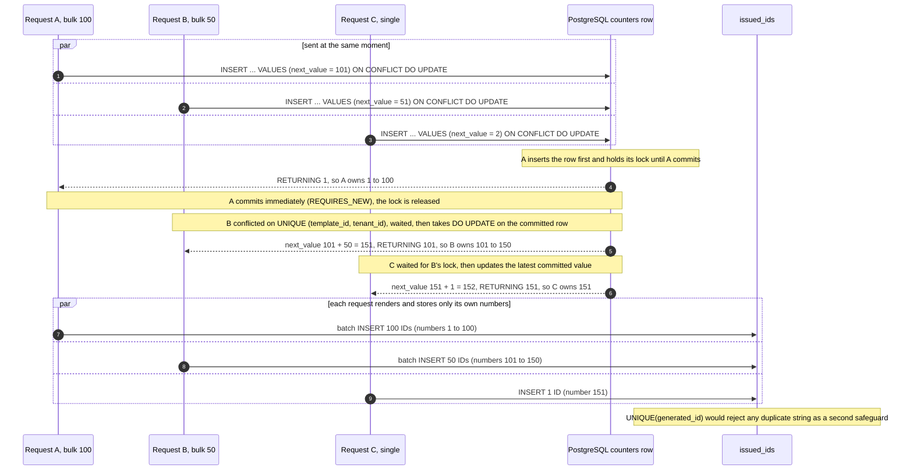
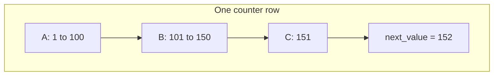

# Concurrency

Simultaneous requests can never receive the same sequence number, because every range is reserved by **one atomic SQL
statement** on a counter row in PostgreSQL. Back to the [architecture overview](architecture.md).

```sql
-- CounterRepository.allocate  (named counters: the same statement on named_counters, keyed by counter_name)
INSERT INTO counters (template_id, tenant_id, next_value)
VALUES (:template, :tenant, :start + :count)          -- used only if the row does not exist yet
ON CONFLICT (template_id, tenant_id)
DO UPDATE SET next_value = counters.next_value + :count
RETURNING next_value - :count;                       -- first number of the reserved range
```

`:start` is 1 for `[SEQ:n]` counters and the configured `start` for named counters (for example 1000 for `SEQ_WS`).

## Three simultaneous requests on a new counter

Requests A (bulk of 100), B (bulk of 50) and C (single ID) arrive at the same moment for the same template and tenant, and
the counter row does not exist yet.



The lock order depends on timing (B or C could go first); whatever the order, every request receives a different,
contiguous range. The resulting ranges on the counter (for example `PG_RECEIPT` for `ka.bengaluru`):



## Why this is safe

| Mechanism | Guarantee |
| --- | --- |
| Single statement, no read-modify-write in Java | The read and the increment happen inside PostgreSQL, under the row lock. No two transactions can both see the same `next_value`. |
| Row-level lock | `DO UPDATE` locks the counter row. A concurrent request for the **same** counter waits for the commit, then applies its increment to the latest committed value (PostgreSQL re-checks the updated row under READ COMMITTED). |
| `ON CONFLICT` on the unique key | Two first-time requests cannot create two counter rows: the second waits on the unique index entry and continues on the update path instead of failing. Tested with 20 simultaneous first requests per city. |
| Whole range per statement | A bulk request of N reserves N numbers in one step, so ranges never interleave. |
| Own short transaction (`REQUIRES_NEW`) | The lock is held only for that one statement, not while IDs are rendered and inserted. |
| `UNIQUE(generated_id)` on `issued_ids` | Independent of the counter, the database refuses a duplicate string (HTTP 409, nothing issued). |

**Independent counters do not wait for each other.** Locks are per row: different tenants, templates or named counters use
different rows (`counters` keyed by template and tenant, `named_counters` by counter name and tenant), so their requests run
in parallel.

**Failures create gaps, never duplicates.** If a request fails after its range is committed (for example while inserting
issued IDs), those numbers are simply never used. The brief allows gaps; it forbids duplicates.

**Multiple backend instances.** The counter state lives only in PostgreSQL, so the same guarantees hold if more backend
replicas are added.

## Evidence

- `tests/concurrency_test.py` sends genuinely parallel HTTP requests to the running stack: 50 workers × 100 IDs on one counter
  (5,000 unique IDs), 20 simultaneous first-time requests per city, and every template across four tenants with mixed bulk and
  single requests. All runs reported 0 duplicates and 0 failed requests.
- Integration tests in `backend/src/test` cover first IDs, bulk ordering, counter isolation, restarts and the database
  constraints against a real PostgreSQL (Testcontainers).
