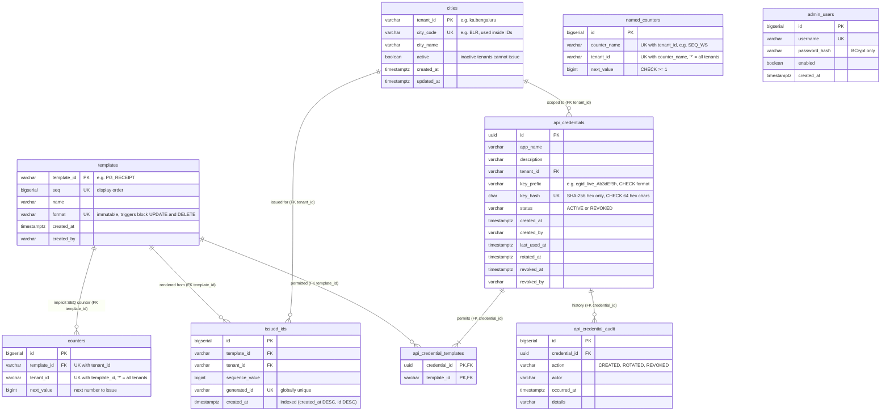

# Data model

The schema after Flyway migrations V1 to V6 (`backend/src/main/resources/db/migration`). Only constraints that exist in the
database are drawn as relationships. Back to the [architecture overview](architecture.md).

## Tables

| Table | Key and uniqueness | Foreign keys (all `ON DELETE RESTRICT`) | Notes |
| --- | --- | --- | --- |
| `cities` | PK `tenant_id`; unique `city_code` | none | Tenants. Seeded from `cities.csv` into an empty table; never deleted, only deactivated. |
| `templates` | PK `template_id`; unique `format`; unique `seq` | none | One immutable format per template. Append-only triggers reject UPDATE, DELETE and TRUNCATE. |
| `counters` | PK `id`; unique (`template_id`, `tenant_id`) | `template_id` to `templates` | Implicit `[SEQ:n]` counters. `tenant_id` has **no** foreign key because it is `*` for formats without `[CITY]`. |
| `named_counters` | PK `id`; unique (`counter_name`, `tenant_id`) | none | `[SEQ_NAME:n]` counters, shared by every template whose format names the counter. The link to templates is the counter name inside the format text, not a foreign key. Start values come from `templates.json`. |
| `issued_ids` | PK `id`; unique `generated_id` | `template_id` to `templates`; `tenant_id` to `cities` | Every ID ever issued. Indexes on (`created_at DESC`, `id DESC`) for recent IDs and analytics, and on `tenant_id`. |
| `api_credentials` | PK `id` (UUID); unique `key_hash` | `tenant_id` to `cities` | API keys for external applications. Only the SHA-256 hash and an 18-character display prefix are stored; CHECK constraints reject anything else. `status = 'REVOKED'` exactly when `revoked_at` is set. |
| `api_credential_templates` | PK (`credential_id`, `template_id`) | `credential_id` to `api_credentials`; `template_id` to `templates` | Templates a credential may use (at least one, enforced by the application). |
| `api_credential_audit` | PK `id` | `credential_id` to `api_credentials` | Who created, rotated or revoked a credential, and when. |
| `admin_users` | PK `id`; unique `username` | none | Created from environment variables at first start; password stored as a BCrypt hash. |

**Cardinalities.** A tenant has zero or more issued IDs; a template has zero or more issued IDs and zero or more implicit
counters (one per tenant, or a single `*` counter); each issued ID belongs to exactly one tenant and one template. Because the
foreign keys are `ON DELETE RESTRICT` (and templates are additionally protected by triggers), neither a tenant nor a template
that has issued IDs can be removed.

**Not tables of the application.** `flyway_schema_history` is maintained by Flyway. Migration V3 once added
`template_versions` and `template_audit_log`; V4 removed them when template versioning was dropped, so they do not exist in
the current schema.
