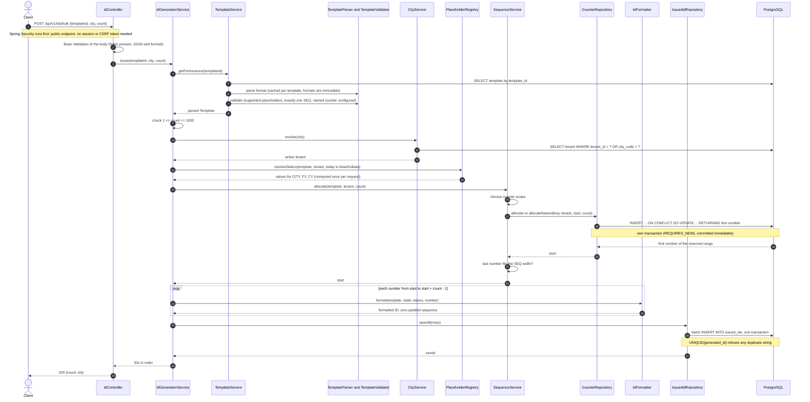

# ID generation sequence

One request to `POST /api/v1/ids/bulk` (or `/issue`, which is the same flow with `count = 1`) passes through the steps below.
Participant names are the actual classes. Back to the [architecture overview](architecture.md).

## Step notes

| Steps | What happens | Failure (HTTP status, body from `GlobalExceptionHandler`) |
| --- | --- | --- |
| 1–3 | Spring Security lets the public ID endpoints through without a session; the controller validates the JSON body. | Missing field or malformed JSON: 400 |
| 4–8 | The template is loaded from the `templates` table, parsed by the generic `TemplateParser` (result cached by template ID, safe because templates never change) and checked by `TemplateValidator`. | Unknown template: 404. Unsupported placeholder, invalid date pattern, unconfigured named counter in strict mode: 422 |
| 9 | The count is checked against `idgen.max-bulk-count` (1000). | 400 |
| 10–12 | The tenant is found by tenant ID or city code (case-insensitive) in `cities`. | Unknown: 404. Inactive: 422 |
| 13–14 | `CITY`, `FY` and `CY` are resolved once, so every ID in a bulk request shares the same date values. | none |
| 15–22 | `SequenceService` picks the counter: `[SEQ:n]` uses `counters` keyed by (template ID, tenant); `[SEQ_NAME:n]` uses `named_counters` keyed by (counter name, tenant); the tenant is `*` when the format has no `[CITY]`. The whole range is reserved by one atomic statement, committed on its own. See [Concurrency](concurrency.md). | Range exceeds the SEQ width: 409 (the reserved numbers become a gap) |
| 23–24 | Each ID is rendered from the parsed segments with the sequence zero-padded to its width. | none |
| 25–27 | All IDs are inserted in one transaction. | Duplicate string (should never happen): 409, nothing issued. Any other failure: 500 with a generic message; the reserved numbers become a gap. |
| 28–29 | The IDs are returned in sequence order. | none |

Because the counter is committed before the IDs are rendered and stored, the worst outcome of a failure is an unused range
(a gap). A duplicate cannot happen: the range belongs to this request alone, and the database rejects any repeated string.
